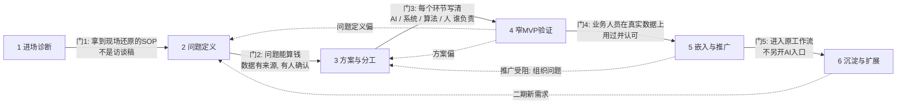
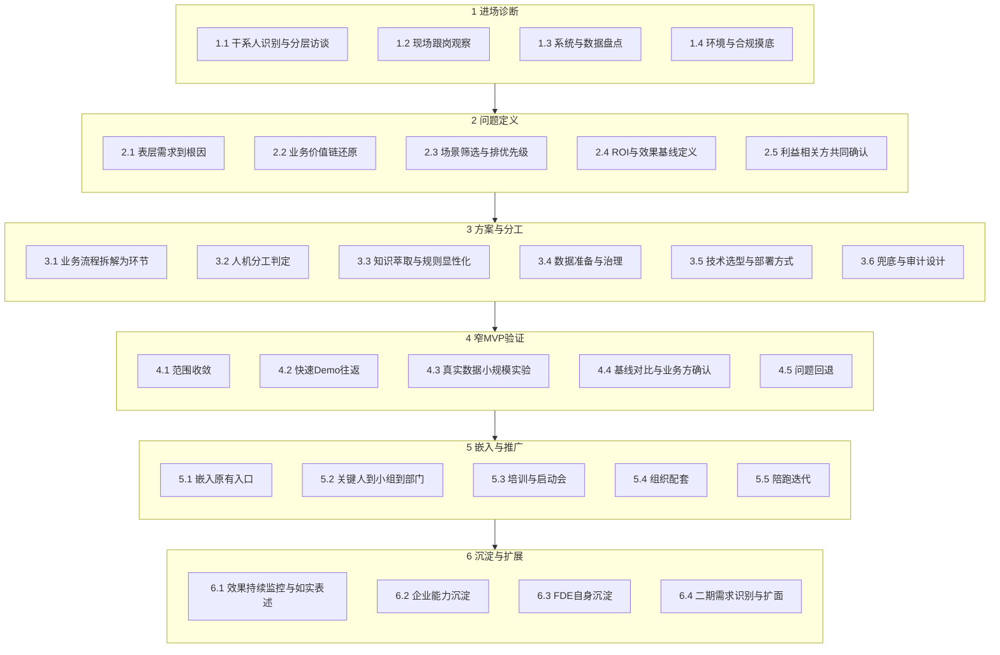
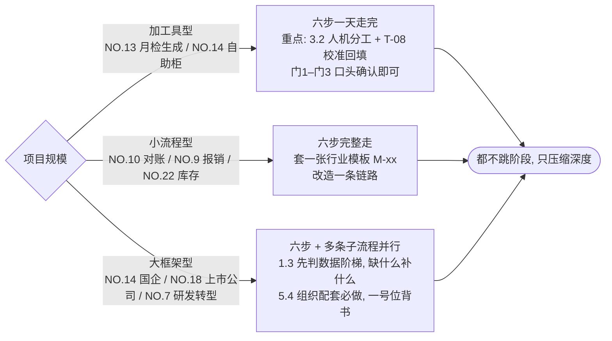

# FDE 落地六步法 · 总览

## 0. 结构说明

整套方法是一棵三层树：

- **阶段**（大框架）：6 个，固定不加不减。每个阶段有目标和"关门条件"，门不过不进下一阶段。
- **子流程**：挂在阶段下，有触发条件、输入、步骤、输出、退出标准、失败回退去向。可单独执行。
- **工具**：挂在子流程的某一步上，自带内部流程。分两类：
  - **循环工具**：被多个子流程反复调用，是 FDE 的通用手法，单独成册（见 `07-循环工具.md`）。
  - **阶段专属工具与行业模板**：只在某处用，跟行业走（见 `08-行业业务模板与专属工具.md`）。

编号规则：阶段 `N`，子流程 `N.x`，循环工具 `T-xx`，行业模板 `M-xx`，专属工具 `P-xx`。

文件清单：

| 文件 | 内容 |
|---|---|
| `00-总览.md` | 本文件：六阶段、全景树、工具挂载矩阵、项目规模入口、规则 |
| `01-进场诊断.md` | 阶段 1 及子流程 1.1–1.4 |
| `02-问题定义.md` | 阶段 2 及子流程 2.1–2.5 |
| `03-方案与分工.md` | 阶段 3 及子流程 3.1–3.6 |
| `04-窄MVP验证.md` | 阶段 4 及子流程 4.1–4.5 |
| `05-嵌入与推广.md` | 阶段 5 及子流程 5.1–5.5 |
| `06-沉淀与扩展.md` | 阶段 6 及子流程 6.1–6.4 |
| `07-循环工具.md` | 12 个跨子流程循环使用的工具，各带内部流程 |
| `08-行业业务模板与专属工具.md` | 8 类行业业务流程模板 + 阶段专属工具 |

---

## 1. 六个阶段与关门条件

| 阶段 | 目标 | 关门条件 | 典型耗时（文档口径） | 案例依据 |
|---|---|---|---|---|
| 1 进场诊断 | 看清企业每天怎么工作、数据在哪一档、谁是干系人 | 有一份现场还原的 SOP | 几天到数月（NO.8 数月） | NO.1 跟岗、NO.3 早九点观察、NO.19 Agent 进群、NO.22 录屏 |
| 2 问题定义 | 把模糊抱怨追到根因，挂到收入 / 成本 / 风险 | 能说出"解决后一年值多少钱、数据从哪来、谁确认" | 与阶段 1 交织 | NO.8 ERP→财务损失、NO.14 要 AI 化→三个真实需求 |
| 3 方案与分工 | 决定哪一步给 AI、专业系统、传统算法、人 | 每个环节有归属，不确定项有人兜底 | 1–4 周 | NO.4 工具调度、NO.9 AI 判断 RPA 执行、NO.21 AI 生成人决策 |
| 4 窄 MVP 验证 | 一个部门 / 一条产品线 / 几个门店，真实数据跑通 | 业务人员用过并说"有效" | 2 周见初步结果（NO.8） | NO.24 一国一线一问题、NO.10 个位数门店 |
| 5 嵌入与推广 | 放回原工作流，关键人→小组→部门 | 员工不用学新系统，AI 是流程里一个节点 | 试运行 1–2 月（NO.17），陪跑约 2 月（NO.1） | NO.17 六步推广、NO.2 RPA 串系统 |
| 6 沉淀与扩展 | 知识 / Skill / SOP / 内部团队留在企业；进二期 | 客户开始自己提需求、自己搭小工具 | 持续 | NO.14 行政自建 Agent、NO.18 20 编制、NO.4 部门自建 Skill |

---

## 2. 全景树：阶段 → 子流程

---

## 3. 循环工具 × 子流程 挂载矩阵

| 循环工具 | 1.x | 2.x | 3.x | 4.x | 5.x | 6.x |
|---|---|---|---|---|---|---|
| T-01 跟岗观察卡 | 1.2 | 2.1 | 3.3 | | 5.5 | |
| T-02 干系人分层对齐表 | 1.1 | 2.5 | | | 5.4 | |
| T-03 追问链 | | 2.1 2.2 | | 4.5 | | |
| T-04 场景评分卡 | | 2.3 | | | | 6.4 |
| T-05 人机分工决策树 | | | 3.2 | 4.5 | | 6.4 |
| T-06 快速 Demo 往返 | | | 3.1 | 4.2 | 5.5 | |
| T-07 效果基线表 | | 2.4 | | 4.4 | | 6.1 |
| T-08 人工校准回填环 | | | 3.6 | 4.3 | 5.5 | 6.1 |
| T-09 评估样本集 | | | 3.5 | 4.3 | 5.5 | |
| T-10 知识萃取 / 岗位说明书 | | | 3.3 | | | 6.2 |
| T-11 收敛范围法 | | | | 4.1 | | 6.4 |
| T-12 AI 辅助 FDE 自己 | 1.2 | 2.1 | | 4.2 | | |

---

## 4. 三档项目规模，同一套六步

---

## 5. 维护规则

1. 阶段只有 6 个。新东西先问：它是哪个阶段的子流程，还是哪个子流程的工具。
2. 子流程必须写"退出标准"和"失败回退到哪个阶段"，否则只是一个标题。
3. 工具必须写"自带流程"和"挂在哪些子流程"，一个都挂不上的不入库。
4. 循环工具单独成册，跨行业通用；阶段专属工具跟行业模板走。
5. 每完成一个项目，回头看：哪一步没工具可用、哪个门形同虚设、哪个子流程被跳过——补进对应文件。
