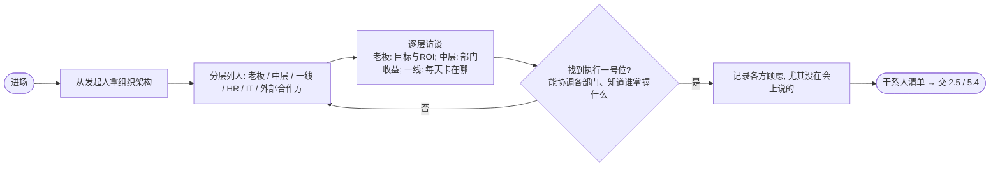
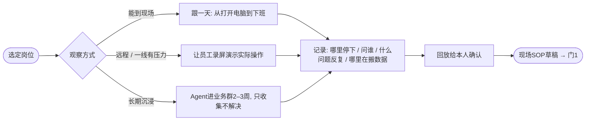
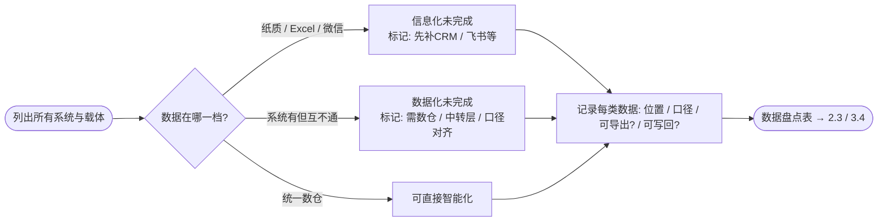

# 阶段 1 · 进场诊断

**目标**：看清企业每天怎么工作、数据在哪一档、谁是干系人，先把技术往后放。

**关门条件（门 1）**：拿到一份现场还原的 SOP（谁做 / 输入 / 输出 / 判断点 / 耗时），不是会议室访谈稿。

**案例依据**：NO.1 跟岗、NO.2 运维项目入场驻场、NO.3 早九点观察与旁听、NO.8 数月访谈 15 团队、NO.9 业务陪跑、NO.13 逐一沟通各岗位、NO.19 Agent 进业务群、NO.22 录屏演示。

**常见失败**：只听老板讲；一线在正式访谈里不敢说（NO.13）；企业自述能力 ≠ 现场真实能力（NO.7）。

---

## 1.1 干系人识别与分层访谈

- **触发**：进场第一周。
- **输入**：组织架构、项目发起人。
- **输出**：干系人清单（角色 / 关心什么 / 怕什么 / 谁拍板 / 谁是执行一号位）。
- **退出标准**：老板、中层、一线三层各至少谈过一轮；找到能协调各部门的"执行一号位"（NO.4）。
- **失败回退**：无。此子流程不通则项目不启动。
- **工具**：T-02 干系人分层对齐表。

## 1.2 现场跟岗观察

- **触发**：访谈拿不到细节，或一线说不清自己的隐性经验。
- **输入**：1.1 选出的关键岗位。
- **输出**：一天工作时间线，标出停顿点、问人点、重复问题、跨系统搬运点。
- **退出标准**：能复述该岗位一天怎么过，且被本人确认"就是这样"。
- **失败回退**：无，换观察方式（录屏 / Agent 进群）。
- **工具**：T-01 跟岗观察卡、T-12 AI 辅助 FDE 自己（Agent 进群总结）。

## 1.3 系统与数据盘点

- **触发**：与 1.2 并行。
- **输入**：企业现有系统清单（ERP / OA / CRM / SaaS / Excel / 微信 / 纸质）。
- **输出**：数据阶梯判定（信息化 / 数据化 / 智能化）+ 每类数据在哪、口径是否一致、能否导出写回。
- **退出标准**：能回答"AI 需要的数据今天存在吗、在谁手里、拿得出来吗"。
- **失败回退**：判定为信息化未完成 → 阶段 3 的 3.4 先补基础，不直接上模型（NO.13、NO.18）。
- **工具**：P-01 数据阶梯判定表。

## 1.4 环境与合规摸底

- **触发**：涉及跨境、央国企、金融、上市公司，或需在客户电脑运行。
- **输入**：数据出域限制、模型使用限制、网络与设备情况、第三方 API 条款。
- **输出**：约束清单（哪些数据不能出、能用哪类模型、API 能否多团队共用、内网是否可达）。
- **退出标准**：约束写清，且已启动权限 / 数据申请（NO.5 花了约一个月）。
- **失败回退**：无，约束进入 3.5 技术选型。
- **工具**：P-02 环境合规清单。

