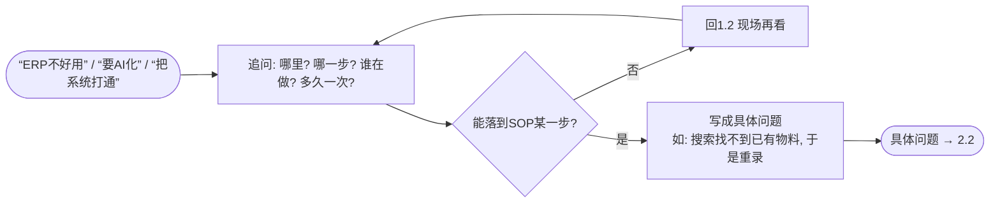
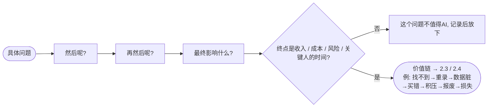
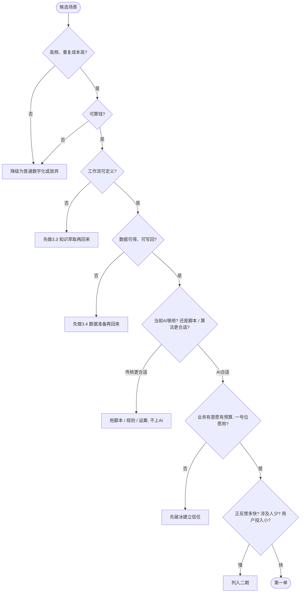
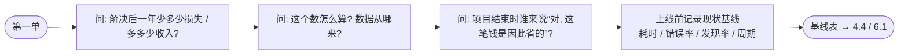
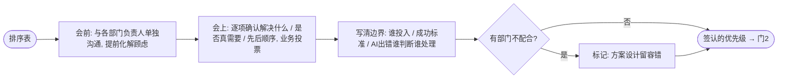

# 阶段 2 · 问题定义

**目标**：把模糊抱怨追到根因，挂到收入 / 成本 / 风险上，选出第一单。

**关门条件（门 2）**：能说出"这个问题解决后一年值多少钱、数据从哪来、最后谁确认"，并且业务部门自己愿意做。

**案例依据**：NO.2 十个最重要问题、NO.4 五问、NO.8 "ERP 不好用"追到财务损失、NO.10 第一单权衡、NO.14 "要拥抱 AI"拆成三个真实需求、NO.17 三条件、NO.18 四维模型、NO.20 问老板"每天最担心什么"、NO.22 "打通两个系统"拆成整条链。

**常见失败**：拿着锤子找钉子（NO.8）；直接把需求列表变功能列表；为 AI 而 AI（NO.20 金融机构生图反例）。

---

## 2.1 表层需求到根因

- **触发**：客户给出一句话需求。
- **输入**：原话 + 1.2 现场 SOP。
- **输出**：一个具体的、发生在某一步、由某人承担的问题。
- **退出标准**：问题能定位到 SOP 里的具体环节，而不是"系统不好用"。
- **失败回退**：回 1.2 补观察。
- **工具**：T-03 追问链、T-01 跟岗观察卡、T-12 AI 辅助整理。

## 2.2 业务价值链还原

- **触发**：2.1 得到具体问题。
- **输入**：具体问题。
- **输出**：一条从问题到财务结果的链。
- **退出标准**：链的终点是钱、时间、风险或收入，且业务方认可这条链成立。
- **失败回退**：链断了 → 回 2.1 换问题。
- **工具**：T-03 追问链。

## 2.3 场景筛选与排优先级

- **触发**：候选场景 ≥ 2 个。
- **输入**：候选场景清单 + 各自价值链 + 1.3 数据盘点。
- **输出**：排序后的场景表，标出第一单。
- **退出标准**：第一单同时满足：业务真痛、实现可控、ROI 快可见、涉及人少、流程清晰、一号位愿用。
- **失败回退**：全部不满足 → 先做加工具型小点破冰（见 `00-总览` 第 4 节）。
- **工具**：T-04 场景评分卡、T-05 人机分工决策树（粗判是否需要 AI）。

## 2.4 ROI 与效果基线定义

- **触发**：第一单选定。
- **输入**：价值链 + 现状数据。
- **输出**：基线表（人工耗时 / 错误率 / 发现率 / 周期 / 金额）+ 目标 + 谁确认。
- **退出标准**：基线数字已记录，确认人已点头。
- **失败回退**：现状数据不存在 → 先做一轮人工采样记录，再进阶段 3。
- **工具**：T-07 效果基线表。

## 2.5 利益相关方共同确认

- **触发**：涉及多部门（NO.8 十几个部门、NO.4 十个部门）。
- **输入**：2.3 排序表、1.1 干系人清单。
- **输出**：各方签认的优先级 + 边界（谁投入什么、做到什么算成功、AI 出错谁判断）。
- **退出标准**：没在会上说的顾虑已单独化解；责任边界写清（NO.10）。
- **失败回退**：某部门不配合 → 3.6 方案留容错，少一个部门少一个场景，链路仍需跑通（NO.4）。
- **工具**：T-02 干系人分层对齐表。

