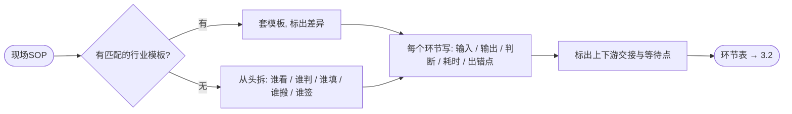
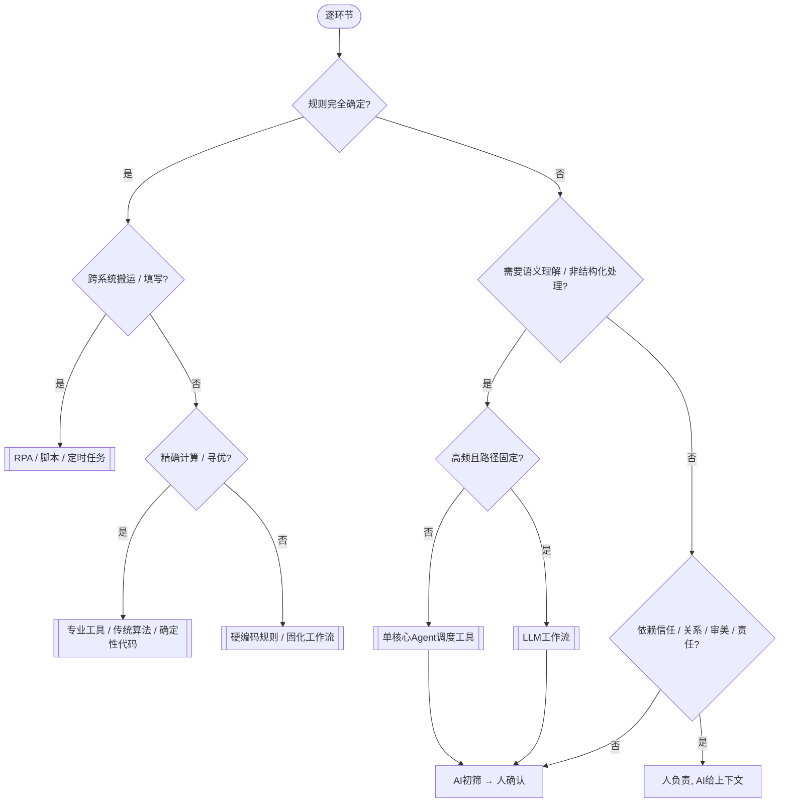
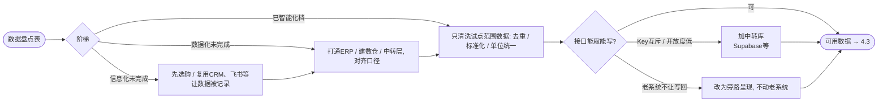
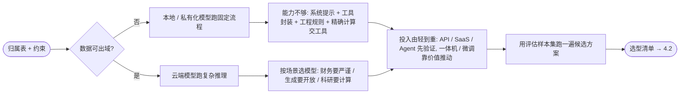
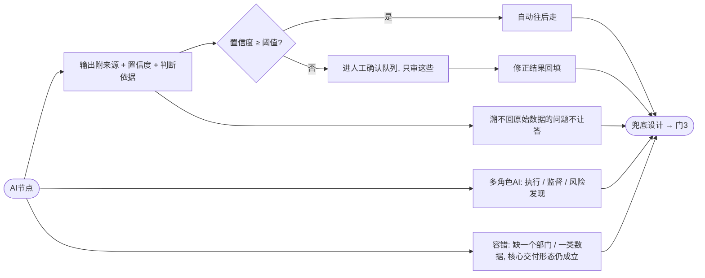

# 阶段 3 · 方案与分工

**目标**：把业务流程拆到环节，决定每一步交给 AI、专业系统、传统算法还是人；把数据和知识准备好。

**关门条件（门 3）**：每个环节有归属；不确定项有人兜底；数据拿得到；部署方式符合 1.4 约束。

**案例依据**：NO.3 大模型 + 专业系统分工、NO.4 模型理解 / 工具计算 / 人决策、NO.6 大模型调度 + 算法计算、NO.9 AI 判断 + 监督 + RPA 执行、NO.14 先梳理流程再做 Agent、NO.17 端到端出价失败改为结构化 + 规则匹配、NO.19 三层拆分、NO.21 规则引擎 + 人决策、NO.22 脚本 vs Agent。

**常见失败**：把所有事塞给大模型；多智能体互聊导致上下文丢失（NO.4）；跳过知识萃取直接让模型"自己理解业务"（NO.14）。

---

## 3.1 业务流程拆解为环节

- **触发**：门 2 通过。
- **输入**：现场 SOP、行业业务模板 M-xx（若有）。
- **输出**：环节表（序号 / 谁做 / 输入 / 输出 / 判断点 / 耗时 / 出错点）。
- **退出标准**：每个环节能独立描述；上下游交接点清楚。
- **失败回退**：环节说不清 → 3.3 先萃取。
- **工具**：M-xx 行业业务模板、T-06 快速 Demo 往返（用 Demo 逼出隐藏环节）。

## 3.2 人机分工判定

- **触发**：环节表就位。
- **输入**：环节表。
- **输出**：每个环节标注归属：RPA / 脚本、专业工具 / 算法、LLM 工作流、Agent、人、AI 初筛 + 人确认。
- **退出标准**：所有环节有归属；涉及信任、责任、审美、最终决策的环节留给人。
- **失败回退**：某环节 AI 不够用且人也不想做 → 回 2.3 重估该场景。
- **工具**：T-05 人机分工决策树。

## 3.3 知识萃取与规则显性化

- **触发**：环节依赖老师傅 / 法务 / 优秀运营的隐性经验。
- **输入**：关键人、历史产出物（合同、报价单、文案、图纸）。
- **输出**：显性规则 / 字段 / 思维框架 / 例外清单，可进知识库或流程节点。
- **退出标准**：本人确认"我就是这么判断的"；例外情况有列举。
- **失败回退**：本人不愿交出 → 5.4 先解决"替代 vs 助手"定位与激励，再回来。
- **工具**：T-10 知识萃取 / 岗位说明书、T-01 跟岗观察卡、P-03 知识地图、P-04 Spec 文档模板。

## 3.4 数据准备与治理

- **触发**：1.3 判定数据不在智能化档，或数据脏、口径不一、接口受限。
- **输入**：数据盘点表、1.4 约束清单。
- **输出**：可用数据（清洗、标准化、口径对齐）+ 取数写回路径。
- **退出标准**：MVP 范围内的数据干净、可取可写；不求全量。
- **失败回退**：数据根本不存在 → 回 2.3 换场景，或先补信息化（CRM / 飞书表）。
- **工具**：P-01 数据阶梯判定表、P-05 API 中转库、T-11 收敛范围法（只治理试点范围的数据）。

## 3.5 技术选型与部署方式

- **触发**：分工与数据就位。
- **输入**：3.2 归属表、1.4 约束、成本预算。
- **输出**：模型 / 组件 / 部署方式清单（云 / 本地 / 混合），按场景选模型。
- **退出标准**：满足合规；成本可算；不为先进而先进（NO.5、NO.7 由轻到重）。
- **失败回退**：本地模型能力不够 → 系统提示 / 工具封装 / 工程规则弥补，精确计算交工具（NO.4）。
- **工具**：P-06 混合部署清单、T-09 评估样本集（选型时跑一遍）。

## 3.6 兜底与审计设计

- **触发**：任何对外输出、涉及责任的环节（报价、审核、财务、图纸）。
- **输入**：归属表中标为"AI 初筛 + 人确认"的环节。
- **输出**：置信度阈值、人工确认点、溯源要求、降级策略、容错设计。
- **退出标准**：每个 AI 结论能追到原始数据；不确定项有人接；少一个部门链路仍通。
- **失败回退**：无。
- **工具**：T-08 人工校准回填环、P-07 "一文一图一表"容错原则。

