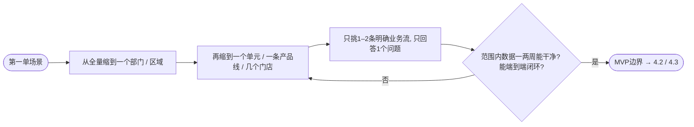
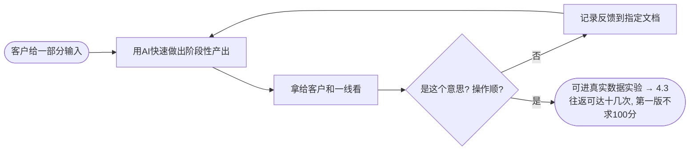
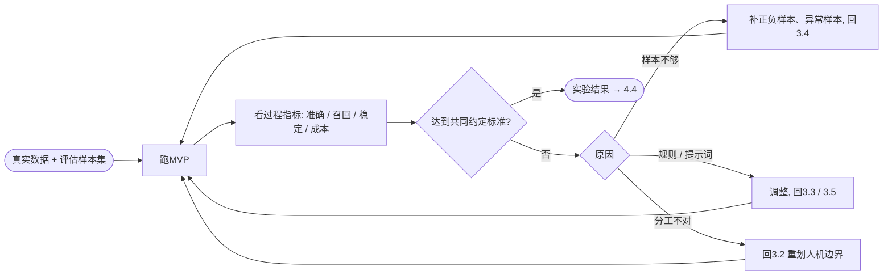
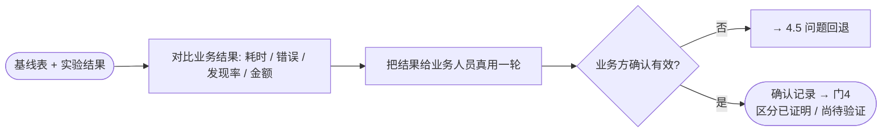
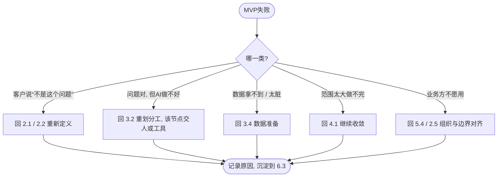

# 阶段 4 · 窄 MVP 验证

**目标**：在一个足够小、足够真实、能闭环的范围里，用真实数据跑通，让业务人员亲眼看到有效。

**关门条件（门 4）**：业务人员在真实数据上用过并说"有效"；与基线对比有数字；问题定义与方案没有被推翻。

**案例依据**：NO.4 全市→一区→米市巷→两条流、NO.8 两周见结果、NO.10 上海个位数门店、NO.12 Demo→使用→反馈→迭代、NO.17 阶段性产出往返十几次、NO.24 只做中国一条产品线一个问题。

**常见失败**：一开始就接全部系统陷入永远做不完的数据工程（NO.4）；Demo 看起来好但没人真用（NO.14）；把"能跑"当"能落地"（NO.16）。

---

## 4.1 范围收敛

- **触发**：进入阶段 4。
- **输入**：第一单场景、3.4 数据现状。
- **输出**：MVP 边界（哪个部门 / 哪条产品线 / 几个门店 / 哪两条业务流 / 回答哪一个问题）。
- **退出标准**：范围内数据能在一两周内治理干净；端到端能闭环（数据能进、结果能出、结论能进会议）。
- **失败回退**：范围仍太大 → 继续缩。
- **工具**：T-11 收敛范围法。

## 4.2 快速 Demo 往返

- **触发**：MVP 边界定了，但需求细节仍模糊。
- **输入**：客户给的一部分输入、3.1 环节表。
- **输出**：阶段性产出（Demo / 一段流程 / 一个功能），以及客户反馈记录。
- **退出标准**：客户说"是这个意思"；反馈已沉淀进文档而非口头。
- **失败回退**：反复多轮仍对不上 → 回 2.1 重新定义问题。
- **工具**：T-06 快速 Demo 往返、T-12 AI 辅助生成 Demo。

## 4.3 真实数据小规模实验

- **触发**：Demo 方向确认。
- **输入**：MVP 范围内真实数据、3.5 选型、3.6 兜底设计。
- **输出**：实验结果 + 过程指标（识别率 / 召回 / 重复数据下降 / 稳定性 / 成本）。
- **退出标准**：过程指标达到与客户共同定的标准（NO.1 解析约 95%、召回 ≥ 80%）；同问同答稳定（NO.16）。
- **失败回退**：指标上不去 → 补样本 / 调规则 / 换分工，回 3.x 对应子流程。
- **工具**：T-09 评估样本集、T-08 人工校准回填环。

## 4.4 基线对比与业务方确认

- **触发**：过程指标达标。
- **输入**：2.4 基线表、实验结果。
- **输出**：业务结果对比（耗时 / 发现率 / 周期 / 金额）+ 业务方确认记录。
- **退出标准**：业务人员亲口说"有效 / 这笔钱确实省下来了"；不是 FDE 自己宣布。
- **失败回退**：业务方不认 → 4.5。
- **工具**：T-07 效果基线表。

## 4.5 问题回退

- **触发**：4.2 对不上、4.3 指标不达、4.4 业务方不认。
- **输入**：失败现象。
- **输出**：回退去向 + 原因记录。
- **退出标准**：明确回到哪个阶段的哪个子流程，不在阶段 4 里空转。
- **工具**：T-03 追问链（追失败原因）、T-05 人机分工决策树（重判）。

