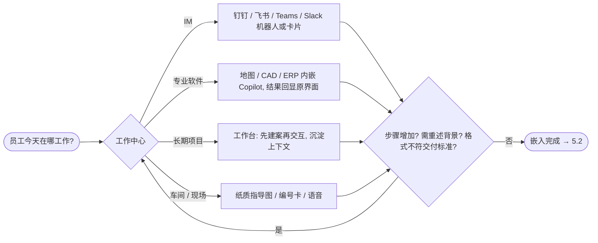
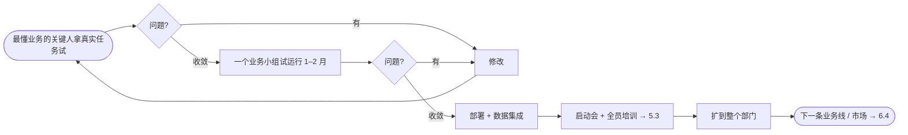
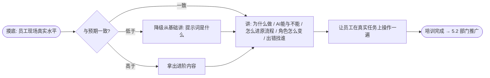
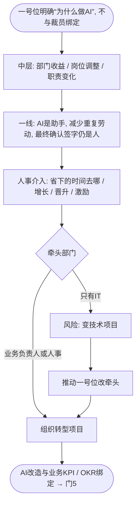
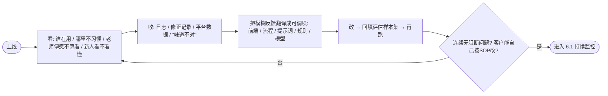

# 阶段 5 · 嵌入与推广

**目标**：把验证过的能力放回原有工作流，从关键人到小组到部门，配套组织与激励，陪跑到真正用起来。

**关门条件（门 5）**：员工不需要学一套新系统；AI 成为原流程中的一个节点；上线后有人持续用，且用法被观察和修正。

**案例依据**：NO.1 接入培训平台陪跑两月、NO.2 RPA 串起既有系统、NO.3 案件工作台、NO.4 地图为中心、NO.9 钉钉机器人入口、NO.16 Teams/Slack、NO.17 关键人→小组→部门、NO.18 高层认知对齐→中层收益→岗位职责、NO.20 飞书卡片提醒。

**常见失败**：多出一个页面还要人复制粘贴（NO.2）；技术跑通员工不愿用（NO.1、NO.14）；IT 牵头变成技术项目（NO.14、NO.20）。

---

## 5.1 嵌入原有入口

- **触发**：门 4 通过。
- **输入**：员工现在在哪里工作（钉钉 / 飞书 / Teams / CAD / 地图 / ERP / 纸）。
- **输出**：AI 能力出现在原入口，输出形态符合原交付标准（NO.21 设计院格式、NO.6 纸质指导图）。
- **退出标准**：员工操作步骤不增加；不需要重新描述背景（NO.3）。
- **失败回退**：入口设计让人负担增加 → 改入口（对话框→工作台）。
- **工具**：P-08 入口适配清单。

## 5.2 关键人到小组到部门

- **触发**：入口就位。
- **输入**：1.1 干系人清单中最懂业务的人。
- **输出**：分层推广记录与问题清单。
- **退出标准**：关键人 → 小组试运行 1–2 月 → 真实订单验证 → 部门推广，每一层问题都收敛后再扩。
- **失败回退**：某层大量问题 → 停在该层修，不往外扩。
- **工具**：T-06 快速 Demo 往返（修改后回到关键人）。

## 5.3 培训与启动会

- **触发**：小组试运行收敛。
- **输入**：新流程 SOP、员工现有 AI 认知水平。
- **输出**：培训完成；员工能把业务要求转成系统输入、能给出可吸收的反馈。
- **退出标准**：员工知道 AI 能做什么、不能做什么、出错时找谁。
- **失败回退**：现场水平与预期不符 → 现场升降级（NO.7）。
- **工具**：P-09 培训包与启动会模板。

## 5.4 组织配套

- **触发**：AI 开始改变岗位工作量、职责、部门协作，或员工出现"被替代"顾虑。
- **输入**：1.1 干系人清单、老板对生产力释放去向的想法。
- **输出**：AI 定位声明（助手，不是替代）、KPI / 职责 / 激励调整、牵头部门确定。
- **退出标准**：一号位背书；人事参与；员工知道省下的时间去做什么。
- **失败回退**：一号位不背书 → 项目降级为加工具型，不推组织变革。
- **工具**：T-02 干系人分层对齐表、P-10 KPI 与职责调整清单。

## 5.5 陪跑迭代

- **触发**：上线后。
- **输入**：真实使用日志、员工反馈、平台数据。
- **输出**：前端 / 流程 / 提示词 / 规则 / 模型的持续调整。
- **退出标准**：连续一段时间（NO.1 约两月、NO.17 前两月磨合）无阻断性问题；客户能按 SOP 自己继续优化（NO.15）。
- **失败回退**：效果持续不达 → 4.5。
- **工具**：T-08 人工校准回填环、T-09 评估样本集、T-01 跟岗观察卡（再看一次员工怎么用）、T-06 快速 Demo 往返。

