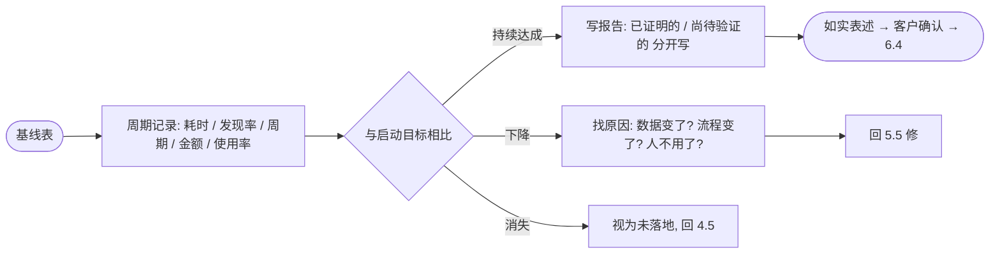
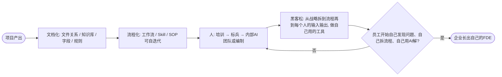
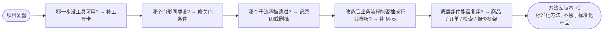
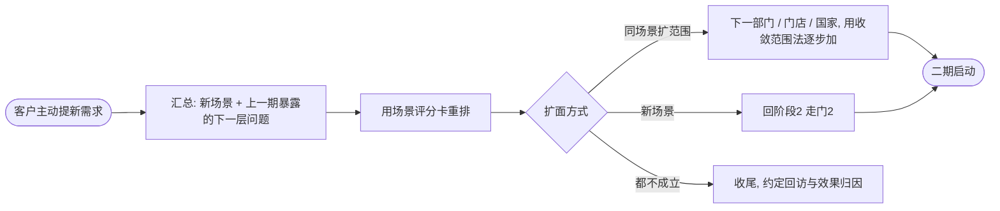

# 阶段 6 · 沉淀与扩展

**目标**：把效果持续证明下去；把知识、Skill、SOP、团队留在企业；FDE 自己也留下方法和组件；识别二期。

**关门条件（阶段出口）**：客户开始自己提需求、自己搭小工具；效果按基线持续可见；FDE 方法库有新增。

**案例依据**：NO.4 部门自建 Skill、NO.8 上线后持续看效果是否还在、NO.11 企业以后先"自己试"、NO.12 两条飞轮、NO.14 行政人员自建 Agent、NO.15 交付预留 SOP、NO.18 20 编制内部团队、NO.19 黑客松业务人员成 Builder、NO.22 效果归因是 FDE 工作的一部分、NO.5 一期完成自然出现二期。

**常见失败**："东西做完、钱到账、人撤走"（NO.8）；交付后权限被移除，效果无法追踪（NO.22）；急着把一个项目包装成标准产品（NO.20）。

---

## 6.1 效果持续监控与如实表述

- **触发**：门 5 通过。
- **输入**：2.4 基线表、运行数据。
- **输出**：周期性效果报告，区分"已证明"与"尚待验证"。
- **退出标准**：运行数月后效果仍在；对外表述与数据一致（NO.20 上线短不夸大、NO.24 脱敏但量级真实）。
- **失败回退**：效果下降 → 找原因回 5.5；效果消失 → 视为未落地，回 4.5。
- **工具**：T-07 效果基线表、T-08 人工校准回填环。

## 6.2 企业能力沉淀

- **触发**：与 5.5 并行。
- **输入**：项目中形成的知识、流程、Skill、SOP。
- **输出**：留在企业的资产：知识库、Skill、工作流、SOP、内部 AI 团队 / 标兵。
- **退出标准**：企业遇到新问题时第一反应从"找人"变成"自己先试"；有人能自己搭小 Agent。
- **失败回退**：无人接手 → 5.4 推动建团队或设标兵。
- **工具**：T-10 知识萃取 / 岗位说明书、P-11 内部黑客松、P-09 培训包。

## 6.3 FDE 自身沉淀

- **触发**：每个项目结束。
- **输入**：本项目走过的六步、失败回退记录、用过的工具。
- **输出**：方法库更新：新增 / 修订子流程卡、工具卡、行业模板；可复用组件。
- **退出标准**：下一个同类项目能少走一段路（NO.5：第一次 100%、第二次 80%、第三次 60%）。
- **失败回退**：无。
- **工具**：本方法库的 `07`、`08` 两个文件。

## 6.4 二期需求识别与扩面

- **触发**：客户看到第一单价值后主动提新需求（NO.11 十几到二十个、NO.22 库存联动广告、NO.5 二期）。
- **输入**：客户新需求清单、6.1 效果报告。
- **输出**：二期场景排序；扩面路径（下一部门 / 国家 / 业务线）。
- **退出标准**：二期第一单选出，回到阶段 2 走门 2。
- **失败回退**：新需求都不成立 → 项目收尾，保留回访机制。
- **工具**：T-04 场景评分卡、T-05 人机分工决策树、T-11 收敛范围法。

