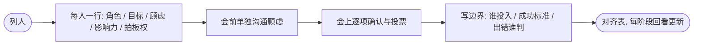
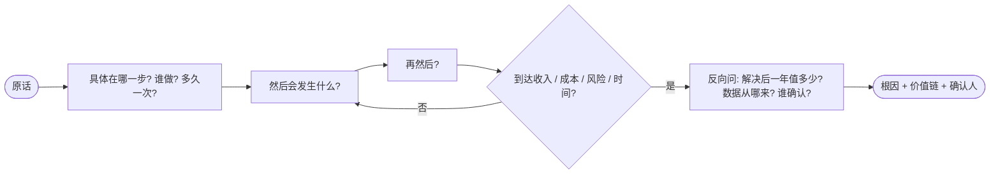
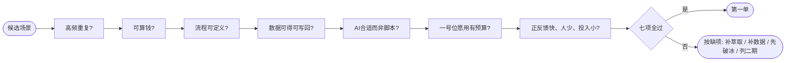
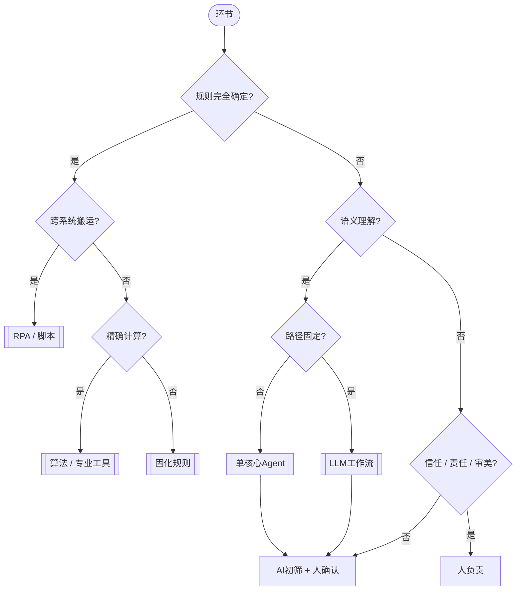
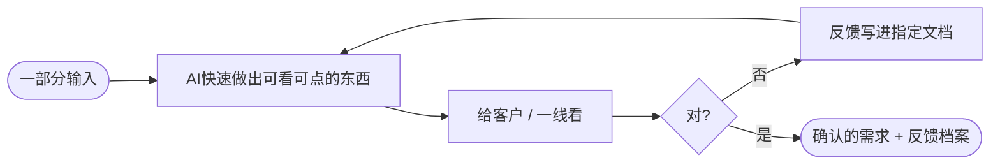
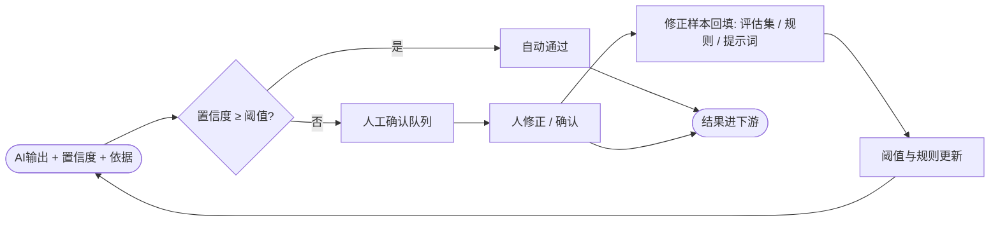
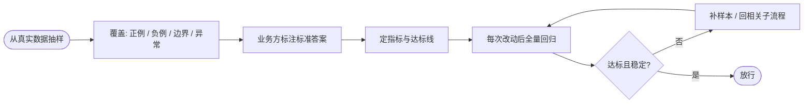
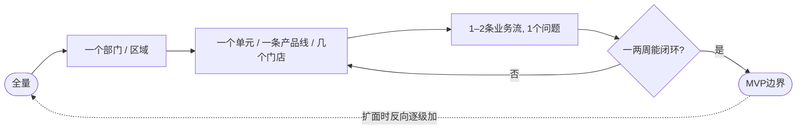

# 循环工具（T-01 ～ T-12）

跨阶段、跨子流程反复调用的工具。每个工具自带内部流程，自成一派；挂载点见 `00-总览.md` 第 3 节矩阵。

工具卡格式：用途 / 挂载子流程 / 内部流程 / 来源案例 / 使用要点。

---

## T-01 跟岗观察卡

- **用途**：把"一天怎么干活"变成可标注的时间线，找停顿点与隐性判断。
- **挂载**：1.2、2.1、3.3、5.5。
- **来源**：NO.1、NO.3、NO.13、NO.22。
- **要点**：只记事实不记结论；一线不敢说时改录屏或 Agent 进群。

## T-02 干系人分层对齐表

- **用途**：老板 / 中层 / 一线 / HR / IT 各要什么、怕什么、会前怎么单独化解。
- **挂载**：1.1、2.5、5.4。
- **来源**：NO.4、NO.8、NO.10、NO.18。
- **要点**：会前单聊，会上只确认；边界写字。

## T-03 追问链

- **用途**：从一句抱怨追到根因与财务终点。
- **挂载**：2.1、2.2、4.5。
- **来源**：NO.4 五问、NO.8、NO.14、NO.22。
- **要点**：追到"收入 / 成本 / 风险 / 关键人时间"四个终点之一才停。

## T-04 场景评分卡

- **用途**：多候选场景排序选第一单。
- **挂载**：2.3、6.4。
- **来源**：NO.2、NO.10、NO.17、NO.18。
- **要点**：七维度全过才是第一单；不过的按缺项回补。

## T-05 人机分工决策树

- **用途**：对每个环节判定交给 RPA / 算法 / LLM 工作流 / Agent / 人 / AI 初筛 + 人确认。
- **挂载**：3.2、4.5、6.4。
- **来源**：NO.4、NO.6、NO.9、NO.17、NO.19、NO.21、NO.22。
- **要点**：规则确定 → 不用大模型；涉及责任 / 信任 / 审美 → 人；其余 AI 初筛人确认。

## T-06 快速 Demo 往返

- **用途**：用阶段性产出逼出真实需求，替代长篇需求文档。
- **挂载**：3.1、4.2、5.2、5.5。
- **来源**：NO.12、NO.14、NO.17、NO.19。
- **要点**：第一版不求满分；反馈必须落到指定文档；往返十几次是正常。

## T-07 效果基线表

- **用途**：上线前记现状，上线后对比，如实区分已证明与待验证。
- **挂载**：2.4、4.4、6.1。
- **来源**：NO.8、NO.20、NO.22、NO.24。
- **要点**：基线没记，效果就说不清；对外表述与数据一致。

## T-08 人工校准回填环

- **用途**：AI 初筛 + 人确认 + 修正回填，边用边准。
- **挂载**：3.6、4.3、5.5、6.1。
- **来源**：NO.1、NO.9、NO.13、NO.14、NO.15、NO.21。
- **要点**：只让人审低置信度部分；修正必须回到样本 / 规则，不然人永远在审。

## T-09 评估样本集

- **用途**：选型、实验、迭代都拿同一套样本跑，防止"感觉变好了"。
- **挂载**：3.5、4.3、5.5。
- **来源**：NO.1 约 95%、NO.5 数据集、NO.15、NO.16 同问同答。
- **要点**：含正例、负例、异常例；标注答案来自业务方；每次修改后全量回归。

## T-10 知识萃取 / 岗位说明书

- **用途**：把老师傅、法务、优秀运营的隐性判断变成显性规则。
- **挂载**：3.3、6.2。
- **来源**：NO.11、NO.13、NO.14、NO.15、NO.19。
- **要点**：让本人"给 AI 写岗位说明书"最有效；翻历史产出物反推；例外清单必须有。

## T-11 收敛范围法

- **用途**：把"全公司"缩到"一个能一两周闭环的点"。
- **挂载**：4.1、3.4、6.4。
- **来源**：NO.4、NO.10、NO.24。
- **要点**：缩到数据能治理干净、端到端能闭环为止；扩面时反向逐步加。

## T-12 AI 辅助 FDE 自己

- **用途**：FDE 自己用 AI 做访谈整理、群聊总结、Demo 生成、调研加速。
- **挂载**：1.2、2.1、4.2。
- **来源**：NO.19 Agent 进群、NO.24 AI 做访谈与调研、NO.14 快速 Demo。
- **要点**：AI 只收集和整理，判断仍由 FDE 与业务方做；进群阶段只收集不解决。

