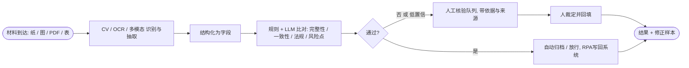
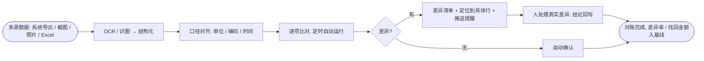
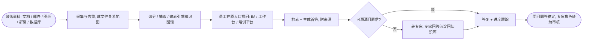
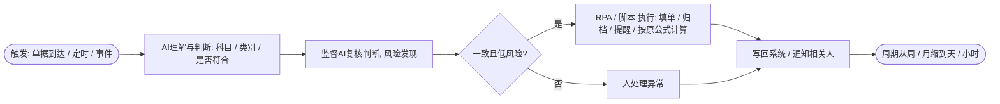
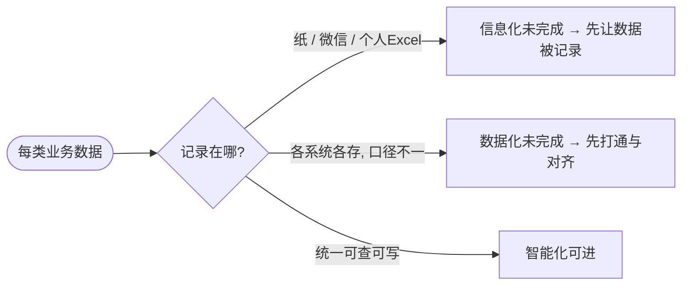
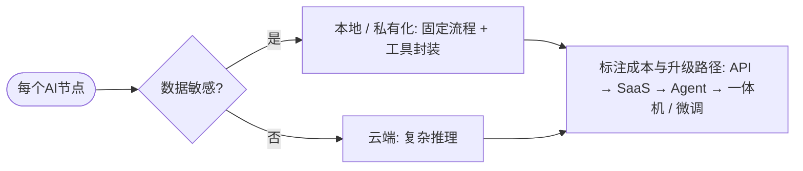
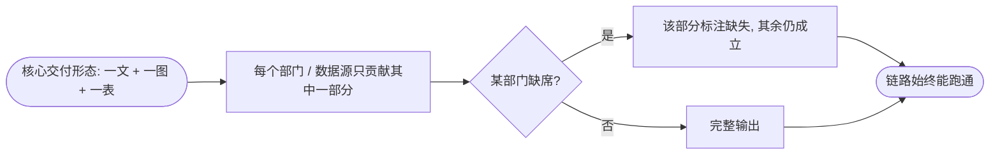
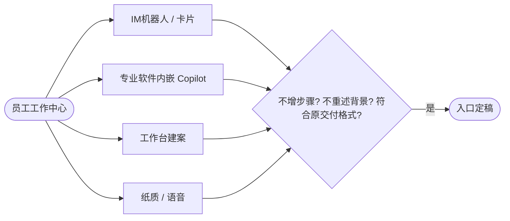

# 行业业务模板（M-01 ～ M-08）与阶段专属工具（P-01 ～ P-11）

- **行业业务模板 M-xx**：从 24 个案例的"改造后流程"抽出的 8 类可套用链路。挂在 3.1 业务流程拆解；进场时先对号，再标差异。
- **阶段专属工具 P-xx**：只在某个子流程用一次的工具，不进循环工具册。

---

# 一、行业业务模板

## M-01 材料 / 文本审核类

- **适用**：材料审核、合同风险筛查、包装法规预审、经销数据审核。
- **来源**：NO.2 车管所、NO.14 合同条款、NO.19 包装审核、NO.24 海外经销。
- **人机边界**：AI 做识别 / 提取 / 规则比对 / 风险标记；人做异常件核验、尺度决策、签字担责。

## M-02 对账 / 数据核对类

- **适用**：商场对账、应付款核对、物流照片回填、经销数据校验。
- **来源**：NO.10 商场对账、NO.20 订单经营透明、NO.22 识图回填、NO.24。
- **人机边界**：AI 做第一轮全量比对与差异定位；人只处理真实差异。

## M-03 报价 / 报告初稿生成类

- **适用**：图纸报价、消防施工图、长尾订单报价、月检报告、跨部门研判报告。
- **来源**：NO.17、NO.21、NO.23、NO.13、NO.4。
- **人机边界**：AI 生成可推敲的初稿；人校准、调参、放行、担责。端到端直接出结果的做法在 NO.17 失败，改为"结构化 + 规则匹配 + 回填"。

## M-04 知识问答 / 企业资料资产化类

- **适用**：新人培训、案件材料整理、企业资料整理、岗位 AI 助手、网络数据问答。
- **来源**：NO.1、NO.3、NO.11、NO.14、NO.16。
- **人机边界**：AI 首答 + 检索 + 整理；老师傅 / 律师 / 老板做复杂判断与验收。

## M-05 判断 + 执行 的流程自动化类

- **适用**：报销、材料归档、达人履约催办、补货计算与联动。
- **来源**：NO.9 AI 判断 + 监督 + RPA、NO.2、NO.5、NO.22。
- **人机边界**：判断用 AI（带监督角色），执行用 RPA / 脚本 / 定时任务，风险异常交人。

## M-06 内容生成 + 校验 Loop 类

- **适用**：商品素材、短视频脚本、销售话术。
- **来源**：NO.12、NO.15、NO.18 陪练。
- **人机边界**：AI 按业务字段批量生成并自检；人做审美复核与语感判断。

## M-07 调度 / 运筹类

- **适用**：装载、跨部门工具调度、复杂 SQL 分析。
- **来源**：NO.6 大模型 + 三维装箱算法、NO.4 单核心 Agent 调度 GIS、NO.16 Agent 系统。
- **人机边界**：大模型理解意图并调度；精确计算交传统算法 / 专业工具；人按结果执行或确认。

## M-08 经营分析 / 数据透明类

- **适用**：销售归因、订单经营透明、海外动销、物料采购浪费。
- **来源**：NO.18、NO.20、NO.24、NO.8。
- **人机边界**：AI 做抽取、清洗、校验、归因、异常提醒；老板与业务负责人做经营决策。

---

# 二、阶段专属工具

| 编号 | 工具 | 挂载 | 来源 |
|---|---|---|---|
| P-01 | 数据阶梯判定表 | 1.3、3.4 | NO.13、NO.18、NO.20 |
| P-02 | 环境合规清单 | 1.4 | NO.5、NO.9、NO.14、NO.24 |
| P-03 | 知识地图 / 文件关系图 | 3.3、6.2 | NO.11 |
| P-04 | Spec 文档模板 | 3.3、3.5 | NO.7 |
| P-05 | API 中转库 | 3.4 | NO.5 Supabase |
| P-06 | 混合部署清单 | 3.5 | NO.5、NO.7、NO.9 |
| P-07 | "一文一图一表"容错原则 | 3.6 | NO.4 |
| P-08 | 入口适配清单 | 5.1 | NO.3、NO.4、NO.6、NO.9、NO.16、NO.20、NO.21 |
| P-09 | 培训包与启动会模板 | 5.3、6.2 | NO.7、NO.17、NO.18 |
| P-10 | KPI 与职责调整清单 | 5.4 | NO.14、NO.18 |
| P-11 | 内部黑客松 | 6.2 | NO.19 |

## P-01 数据阶梯判定表

## P-02 环境合规清单

## P-03 知识地图 / 文件关系图

## P-04 Spec 文档模板

## P-05 API 中转库

## P-06 混合部署清单

## P-07 "一文一图一表" 容错原则

## P-08 入口适配清单

## P-09 培训包与启动会模板

## P-10 KPI 与职责调整清单

## P-11 内部黑客松

